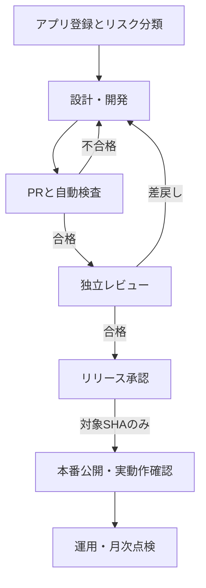

# 株式会社うつろい — AI開発の安全な公開フロー

この提案は、既存の[`utsuroi-inc/.github`](https://github.com/utsuroi-inc/.github)の共通GitHub運用を拡張するものです。

目的は、**チェックに合格し、人が特定バージョンを承認したアプリだけを公開し、実利用へ進める**ことです。

## まず読む順番

1. [`SECURE_DEVELOPMENT.md`](SECURE_DEVELOPMENT.md) — 社内の開発標準と責任分担
2. [`RELEASE_GATES.md`](RELEASE_GATES.md) — 検査・公開の条件と緊急停止
3. [`ROLLOUT_PLAN.md`](ROLLOUT_PLAN.md) — 既存アプリを止めずに段階導入する計画
4. [`OPERATION_PLAYBOOK.md`](OPERATION_PLAYBOOK.md) — 誰が何を確認し、いつ公開・停止するかの実際の運用

## 配布テンプレート

| ファイル | 用途 |
| --- | --- |
| `templates/APP_REGISTER.csv` | 公開・運用するアプリの社内台帳（実データをこの公開Repoに記録しない） |
| `templates/RELEASE_RECORD.md` | 公開するSHAと検査・承認の証跡 |
| `templates/SECURITY_TEST_MATRIX.md` | 認証・認可・公開範囲等のテスト |
| `templates/AGENTS_SECURITY.md` | CodexとClaude Codeへ共通の規則を渡す |
| `templates/workflows/secure-node-ci.yml` | Node.js用GitHub Actionsの出発点 |
| `templates/workflows/secure-static-ci.yml` | HTML＋素のJavaScript用の静的サイト検査。PRで必須化して使う |
| `templates/static-app/verify-static.mjs` | 静的ファイル、JS構文、外部JS、危険API等の最小チェック |
| `templates/static-app/verify-static.test.mjs` | 上記チェッカーの失敗テスト |
| `templates/DEPLOYMENT_INVENTORY.md` | Cloudflareの本番・プレビュー・API・代替デプロイ経路を非公開で棚卸し |

## 重要な注意

- 本文・テンプレートがGitHubへ入るだけでは**リリース制限は有効になりません**。
- 各アプリでGitHub Ruleset、CIの必須チェック、Cloudflareのデプロイ・Access設定が必要です。
- 人が承認するまで、既存本番アプリ・アカウントの権限・公開範囲を変えません。
- 本提案は全社標準案であり、実際の保護は1件のパイロットで遮断試験をしてから導入します。
- 静的サイト用の簡易チェッカーは**SAST・既知脆弱性分析・実機テストの代わりではありません**。別途追加が必要です。

## 運用フロー

`main`を更新できることと、**本番に公開してよいこと**は区別します。全社標準としては、各アプリの公開先がどのブランチ・アクションで動くかを必ず確認してください。
